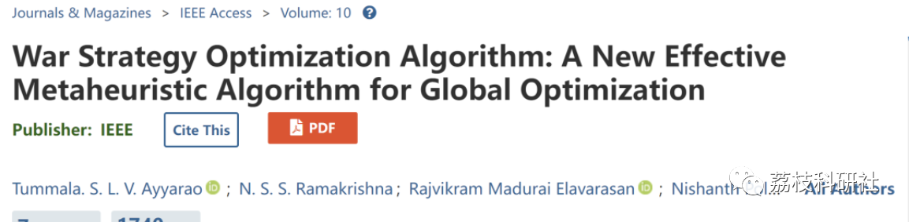
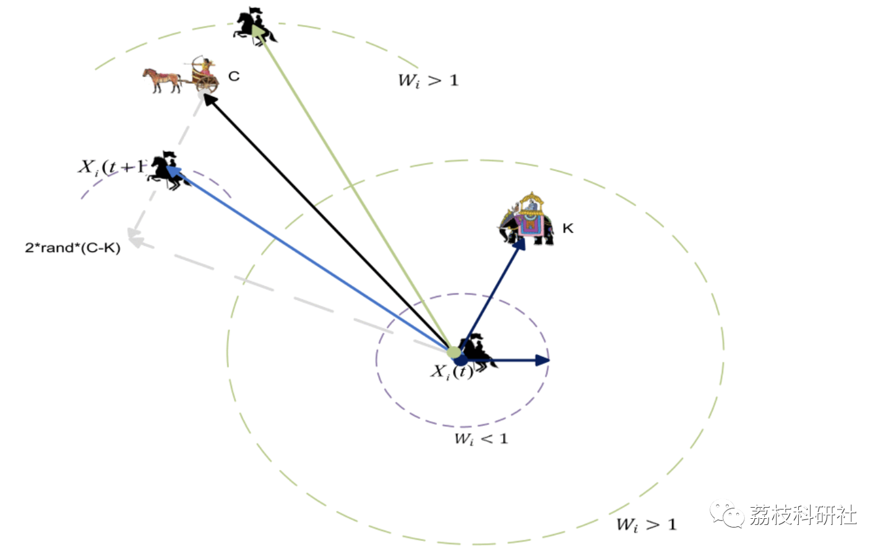

# Optimization Algorithm for War Strategies (WSO) (Matlab Code Implementation)

💥💥💥💞💞💞💞 Welcome to this blog❤️❤️❤️💥💥💥
🏆 Bloggers' Advantage: 🌞🌞🌞 The content of the blog strives to be rigorous in thought and clear in logic, for the convenience of readers.
⛳️ Mantra: The journey of a hundred miles is half done in the last ninety.
Litchi Research Society
Code Collection: Power System, Intelligent Algorithms and Applications, Neural Network Prediction, Path Planning, Optimized Scheduling, Workshop Scheduling, Image Processing, Signal Processing...
🎁Column Directory Link:
🌈🌈🌈🌟🌟🌟Electrical Code Intelligent Algorithm and Its Application Path Planning Neural Network Predictive Optimization Scheduling Image Processing Workshop Scheduling Signal Processing Romantic Her My Philosophical Thoughts Math Modeling Complete Code Matters
💥1 Overview
Warfare Strategy Optimization (WSO) is based on the strategic redeployment of Army units during wartime. The strategy is modeled as an optimization process where each soldier dynamically moves towards the optimal value. The algorithm simulates two popular war strategies, namely attack and defense strategies. The positions of soldiers on the battlefield are updated according to the implemented strategy. To enhance the convergence and robustness of the algorithm, a new weight update mechanism and weak soldier migration strategy are introduced. The proposed warfare strategy algorithm achieves a good balance between exploration and exploitation phases. A detailed mathematical model of the algorithm is provided. The effectiveness of the proposed algorithm is tested on 50 benchmark functions and 4 engineering problems. The performance of the algorithm is compared with ten popular metaheuristic algorithms. Experimental results for various optimization problems demonstrate the superiority of the proposed algorithm.
📚2 Main Function
​\nclear\nclc\n​\nfEvals = 30000;    \n​\npopulationSize=30; % Number of search agents\nMax_iteration = 1000;\nruns = 10;\n​\nfor fn = 1:18\n​\n    Function_name=strcat('F',num2str(fn)); % Name of the test function \n%     [lb,ub,dim,fobj]=Get_Functions_details(Function_name);\n    [lb,ub,dim,fobj]=Get_Functions_Details_Uni(Function_name);\n    \n%     Function_name=strcat('MF',num2str(fn)); % Name of the test function \n%     [lb,ub,dim,fobj]=Get_Functions_Details_Multi(Function_name);\n​\n    % Calling algorithm\n    Best_score_T = zeros(1,runs);\n    for run=1:runs\n        rng('shuffle');\n        tic\n        Best_score_0 =WSO(populationSize,Max_iteration,lb,ub,dim,fobj);\n        toc\n        Best_score_T(1,run) = Best_score_0;\n        \n%         Best_score_0\n    end\n​\n    %Finding statistics\n    Best_score_Best = min(Best_score_T);\n    Best_score_Worst = max(Best_score_T);\n    Best_score_Median = median(Best_score_T,2);\n    Best_Score_Mean = mean(Best_score_T,2);\n    Best_Score_std = std(Best_score_T);\n​\n​\n    %Printing results\n    display(['Fn = ', num2str(fn)]);\n    display(['Median, Mean, and Std. are as: ',  ...\n         num2str(Best_score_Median),'  ', num2str(Best_Score_Mean),'  ', num2str(Best_Score_std)]);\n​\nend\nfigure\nplot(Best_score_T)\n​\n  
🎉3 References
[1]Ayyarao, TummalaS LV, N. S. S. RamaKrishna, Rajvikram Madurai Elavarasam, Nishanth Polumahanthi, M. Rambabu, Gaurav Saini, Baseem Khan, and Bilal Alatas. "War Strategy Optimization Algorithm: A New Effective Metaheuristic Algorithm for Global Optimization." IEEE Access (2022).  
[2]Ayyarao, Tummala SLV, and Polamarasetty P. Kumar. "Parameter estimation of solar PV models with a new proposed war strategy optimization algorithm." International Journal of Energy Research (2022).  
🌈4 Matlab code implementation
Click the "Read Full Content" button at the bottom left of the article.

## Images

<!-- PAYMENT_BLOCK -->

## Get this dataset

- Payment link (Stripe): [Buy now](https://buy.stripe.com/3cs8yP7sY87d0vu9AB)
- Payment QR code: 

<!-- /PAYMENT_BLOCK -->
